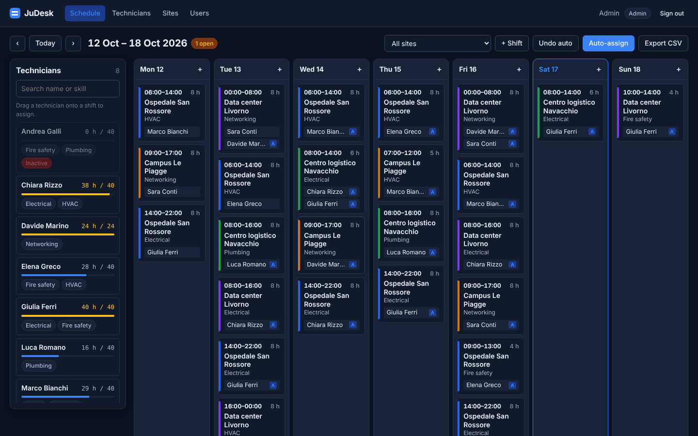

# JuDesk

[](https://github.com/adev0x3b/judesk/actions/workflows/ci.yml)

Shift scheduling for field technicians. A planner keeps a roster of technicians with skills and a weekly hours limit, sites with shifts that need a skill and a headcount, and fills the week by dragging people onto shifts or letting the auto-scheduler do it. Every assignment is checked against the same rules: required skill, no overlapping shifts, weekly hours, headcount. The week exports to CSV.

It grows out of a problem I worked on at Freezanz, where I wrote the route-optimization algorithm that plans the day of the maintenance technicians.

**Stack:** ASP.NET Core 8 minimal API · EF Core 8 · PostgreSQL 16 · Vue 3 + TypeScript (Vite, Pinia) · xUnit + Testcontainers · Vitest · Docker Compose · GitHub Actions.


## What it does

- **Week calendar**: seven day columns, one card per shift with its site colour, time, required skill and one slot per head. Filter by site, step between weeks, see how many slots are still open.
- **Drag and drop**: drag a technician from the side panel onto a shift. While dragging, cards hint whether the person is eligible; the API has the final say and answers with the exact violations.
- **Rule-checked assignment** ([`AssignmentRules`](backend/src/JuDesk.Domain/Scheduling/AssignmentRules.cs)): inactive technician, missing skill, already on the shift, shift full, overlap with another shift that week, weekly hours limit. The hours limit can be overridden by the planner on purpose; the other rules cannot.
- **Shift drawer**: click a shift to see who is assigned and every candidate with their hours and the rules they would break.
- **Auto-assign** ([`AutoScheduler`](backend/src/JuDesk.Domain/Scheduling/AutoScheduler.cs)): a preview lists what it would do and which slots stay open and why, then one click applies it. It is a greedy heuristic: most constrained shifts first (fewest eligible technicians), each slot to the eligible technician with the fewest hours that week. Deterministic, never breaks a rule, and "Undo auto" removes only what it added.
- **CSV export** of the week, one row per slot, unfilled slots included.
- **Technicians, skills, sites** management, and an admin page to create planner and admin accounts.
- **Demo data**: a fleet of 8 technicians, 4 sites and three weeks of shifts around today, seeded on first start.

| Shift drawer with candidates and violations | Auto-assign preview |
| --- | --- |
|  |  |

| Technicians and skills | Dark mode |
| --- | --- |
|  |  |

## Running it

Docker Compose builds and starts PostgreSQL, the API and the web app (nginx serving the Vue build and proxying `/api`).

```bash
docker compose up --build
```

Open <http://localhost:8090> and sign in with `admin@judesk.local` / `ChangeMe123!`. Swagger UI is at <http://localhost:8090/swagger>. Ports, admin credentials and the demo seed are set in `.env` (see [`.env.example`](.env.example)).

For development run the API and the Vite dev server separately; Vite proxies `/api` to the API so the auth cookie stays first-party:

```bash
docker run -d --name judesk-db -e POSTGRES_USER=judesk -e POSTGRES_PASSWORD=judesk -e POSTGRES_DB=judesk -p 5432:5432 postgres:16-alpine
cd backend && dotnet run --project src/JuDesk.Api      # http://localhost:5080
cd frontend && npm install && npm run dev               # http://localhost:5173
```

## The parts worth reading

| Where | What |
| --- | --- |
| [`backend/src/JuDesk.Domain`](backend/src/JuDesk.Domain) | Entities and the scheduling logic, with no dependency on EF Core or ASP.NET so the rules are plain functions over in-memory objects. |
| [`AssignmentRules.cs`](backend/src/JuDesk.Domain/Scheduling/AssignmentRules.cs) | The six constraints, returned as a list of violations with messages the UI shows as is. |
| [`AutoScheduler.cs`](backend/src/JuDesk.Domain/Scheduling/AutoScheduler.cs) | The greedy planner. Works on a snapshot so it never mutates the caller's graph, and explains every slot it leaves open. |
| [`ScheduleService.cs`](backend/src/JuDesk.Api/Services/ScheduleService.cs) | Loads a week, runs the rules, assigns inside a serializable transaction so two planners cannot overfill a slot, applies a plan, writes the CSV. |
| [`Endpoints/`](backend/src/JuDesk.Api/Endpoints) | Minimal API route groups: auth and users, catalog (skills, technicians, sites), shifts and assignments, schedule. Validation errors come back as RFC 7807 problem details. |
| [`CookieAuth.cs`](backend/src/JuDesk.Api/Auth/CookieAuth.cs) | Cookie session (HttpOnly, SameSite=Strict), role policy, and 401/403 instead of redirects. |
| [`DemoSeeder.cs`](backend/src/JuDesk.Api/Data/DemoSeeder.cs) | First admin from configuration, demo fleet around the current week. Idempotent. |
| [`frontend/src/stores/schedule.ts`](frontend/src/stores/schedule.ts) | The week on screen: navigation, site filter, shifts grouped by day, and every mutation (assign, unassign, auto-assign, undo) followed by a reload. |
| [`ShiftCard.vue`](frontend/src/components/ShiftCard.vue), [`TechnicianPanel.vue`](frontend/src/components/TechnicianPanel.vue) | Native HTML5 drag and drop, no library. |
| [`ShiftDrawer.vue`](frontend/src/components/ShiftDrawer.vue) | Candidates with violations, the hours override, unassign, edit, delete. |
| [`frontend/src/api/client.ts`](frontend/src/api/client.ts) | Small typed fetch wrapper that turns problem details into an `ApiError` with field errors and rule violations. |
| [`scripts/smoke.sh`](scripts/smoke.sh) | The compose smoke test CI runs: health, 401 for anonymous, login, week view, a rejected assignment, auto-assign dry run, CSV header, index.html. |

## API

All routes under `/api` need a session except `POST /api/auth/login`; `/api/users` needs the Admin role. Dates are UTC ISO-8601; a week is identified by its Monday.

| Method and path | Purpose |
| --- | --- |
| `POST /api/auth/login`, `POST /api/auth/logout`, `GET /api/auth/me` | Cookie session. Login is rate limited per client address. |
| `GET/POST/DELETE /api/skills` | Skills. A skill that shifts still require cannot be deleted. |
| `GET/POST/PUT/DELETE /api/technicians` | Technicians with skills, weekly hours limit and active flag. |
| `GET/POST/PUT/DELETE /api/sites` | Sites with an optional colour. |
| `GET/POST/PUT/DELETE /api/shifts` | Shifts. `GET` takes `from` and `to` dates. Time and skill are locked while someone is assigned. |
| `GET /api/shifts/{id}/candidates` | Every technician with their hours that week, eligibility and violations. |
| `POST /api/shifts/{id}/assignments` | Assign; `409` with a `violations` array when a rule fails. `overrideHours: true` waives only the hours limit. |
| `DELETE /api/shifts/{id}/assignments/{assignmentId}` | Unassign. |
| `GET /api/schedule/week?weekStart=` | Sites, shifts with assignments, technicians with scheduled hours, open slot count. |
| `POST /api/schedule/auto-assign` | `{ weekStart, dryRun }`: the plan, applied unless `dryRun`. |
| `DELETE /api/schedule/auto-assignments?weekStart=` | Removes the week's auto-generated assignments. |
| `GET /api/schedule/export?weekStart=` | CSV, one row per slot. |

## Tests

```bash
cd backend && dotnet test         # 47 tests
cd frontend && npm run test:unit  # 14 tests
```

- **Domain unit tests** ([`tests/JuDesk.Tests/Unit`](backend/tests/JuDesk.Tests/Unit)): every rule, the week arithmetic, and the scheduler's behaviour (fills when there is capacity, balances hours, plans the most constrained shift first, never proposes a violation, is deterministic, does not mutate its input).
- **API integration tests** ([`tests/JuDesk.Tests/Integration`](backend/tests/JuDesk.Tests/Integration)): one real PostgreSQL started by Testcontainers and the API in process through `WebApplicationFactory`, migrations included. They cover the auth flow and cookie flags, role checks, validation, overlap detected from the database, the hours override, auto-assign and undo, and the CSV output.
- **Front-end tests** ([`frontend/src/__tests__`](frontend/src/__tests__)): week helpers, the fetch client's error mapping, the schedule store, and the shift card's drag-and-drop events and eligibility hints.
- **Compose smoke test** ([`scripts/smoke.sh`](scripts/smoke.sh)) against the built images.

## CI

[`.github/workflows/ci.yml`](.github/workflows/ci.yml) runs three jobs: backend tests (Testcontainers needs Docker on the runner), front-end lint, format check, type-check, unit tests and build, then the compose smoke test on the built images.

The jobs run on a self-hosted runner (`runs-on: [self-hosted, linux]`) while the repository is private, because the account's free hosted minutes for private repositories are used up this month. Before the repository goes public the workflow goes back to `ubuntu-latest` and the self-hosted runner is removed.

## Security notes

- Passwords are hashed with ASP.NET Core's `PasswordHasher` (PBKDF2); the first admin's password comes from configuration and should be changed in `.env`.
- The session cookie is HttpOnly and SameSite=Strict, so cross-site requests do not carry it; the API is only reached through the same origin (nginx in compose, the Vite proxy in development).
- Login is rate limited (10 attempts per minute per client address by default), responses carry `X-Content-Type-Options`, `X-Frame-Options` and `Referrer-Policy`, and the API container runs as a non-root user.
- Not covered: HTTPS termination (put it in front of nginx), password reset, audit log.

## Roadmap

- Technician availability (days off, leave) as a seventh rule.
- Shift templates to roll a week forward.
- An ILP solver behind the same `AutoScheduler` interface, to compare against the greedy plan.
- Multi-tenant teams.
