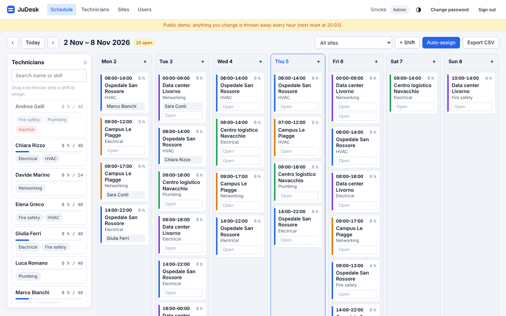
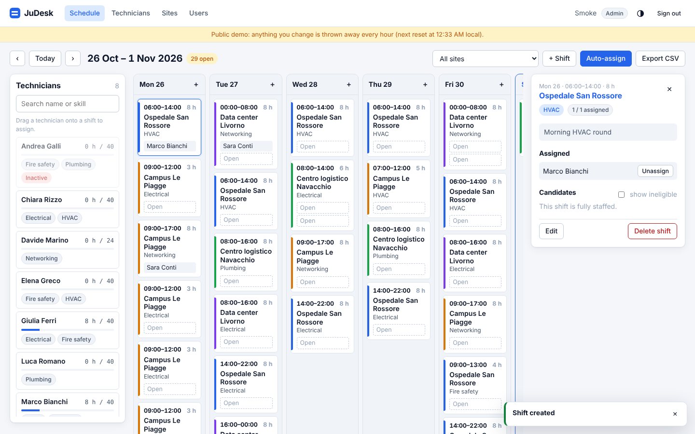
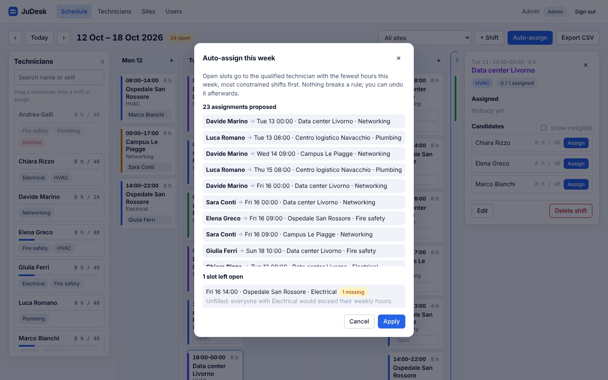
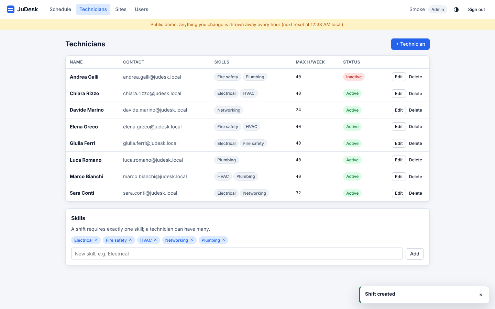
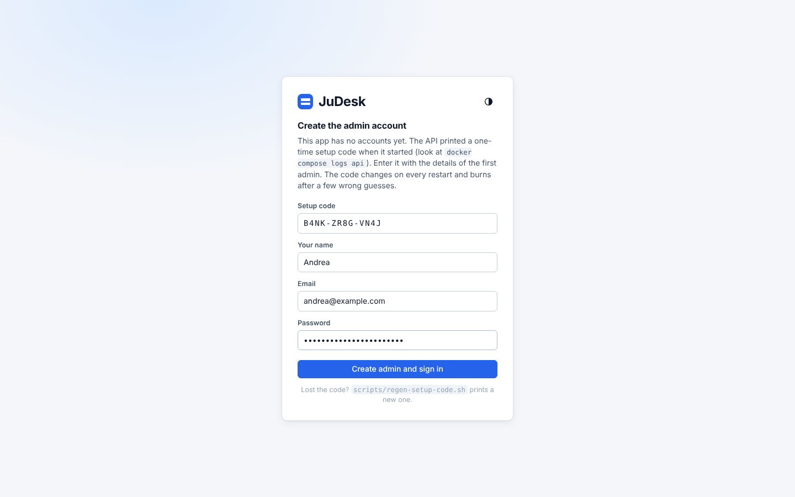
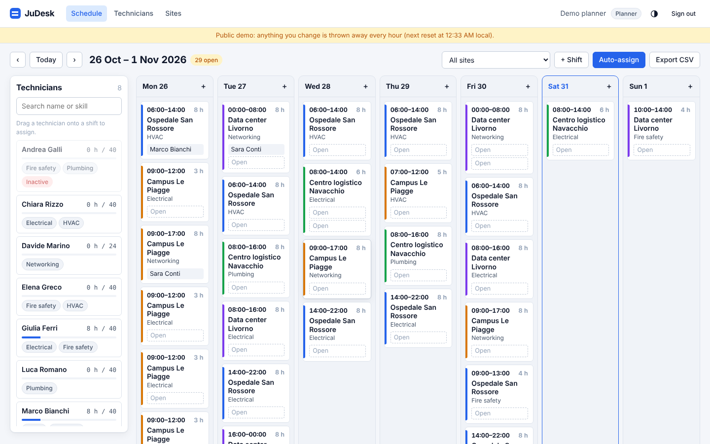
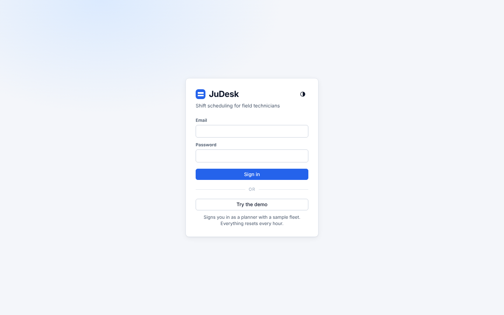

# JuDesk

[](https://github.com/adev0x3b/judesk/actions/workflows/ci.yml)

**Live demo:** <https://desk.juume.site>, click "Try the demo". The data resets every hour.

Shift scheduling for field technicians. Keep a roster of technicians with skills and a weekly hours limit, define shifts per site, and fill the week by dragging people onto shifts or letting the auto-scheduler do it. Every assignment is checked against the same rules: required skill, no overlapping shifts, weekly hours, headcount.



## Features

- **Week view** with one column per day and one card per shift: site, time, required skill, one slot per head. Filter by site, step between weeks, see how many slots are still open.
- **Drag and drop** a technician onto a shift. Cards hint whether the person is eligible while dragging; the server validates and returns the exact violations.
- **Rule checks** on every assignment: inactive technician, missing skill, already on the shift, shift full, overlap with another shift that week, weekly hours limit. A planner can override the hours limit on purpose; the other rules cannot be overridden.
- **Shift details** with everyone assigned and every candidate, their hours this week, and the rules they would break.
- **Auto-assign** for the whole week: preview the plan and the slots that stay open and why, apply it in one click, undo it later. It is a greedy heuristic, most constrained shifts first, each slot to the eligible technician with the fewest hours. Deterministic, never breaks a rule.
- **CSV export** of the week, one row per slot, unfilled slots included.
- **Technicians, skills, sites and users** management. Admins create planner and admin accounts.
- **First-run setup** with a one-time code instead of a default password.
- **Dark mode**, following the system setting.

| Shift details with candidates and violations | Auto-assign preview |
| --- | --- |
|  |  |

| Technicians and skills | First-run setup |
| --- | --- |
|  |  |
| Public demo banner | Login with "Try the demo" |
|  |  |

## Quick start

Requires Docker with Compose.

```bash
git clone https://github.com/adev0x3b/judesk.git
cd judesk
docker compose up --build
```

The `api` service prints a one-time setup code in its log:

```
==========================================================
  JuDesk needs its first admin account.
  Open the app, go to /setup and enter this code:

      ZML3-R379-9SWG

  The code changes on every restart.
  A new one now: scripts/regen-setup-code.sh
==========================================================
```

Open <http://localhost:8090>. Until an admin exists the app shows only the setup page: enter the code with your name, email and password and you are signed in. Only a hash of the code is stored, a fresh one is issued on every restart until setup is done, and five wrong guesses burn it; `scripts/regen-setup-code.sh` prints a new one without a restart.

The database starts with a demo fleet (8 technicians, 4 sites, three weeks of shifts around today) so there is something to schedule. Swagger UI is at <http://localhost:8090/swagger>.

## Configuration

Copy [`.env.example`](.env.example) to `.env` to change the defaults.

| Variable | Default | Purpose |
| --- | --- | --- |
| `WEB_PORT` | `8090` | Host port of the web app. The API is only reachable through it. |
| `WEB_BIND` | `127.0.0.1` | Address the port is published on. `0.0.0.0` opens it to the network. |
| `DB_PASSWORD` | `judesk` | PostgreSQL password. |
| `SEED_DEMO` | `true` | Seed the demo fleet on an empty database. |
| `DEMO_MODE` | `false` | Public demo: "Try the demo" on the login page and a data reset on a timer. |
| `DEMO_RESET_MINUTES` | `60` | How often the demo fleet is put back to the seed. |
| `PROXY_FORWARD_LIMIT` | `1` | Proxies in front of nginx; `2` behind a tunnel or CDN that adds the client address. |

### Public demo

`DEMO_MODE=true` adds a "Try the demo" button to the login page. It signs the visitor in as one shared planner account (random password, never shown), a banner says when the next reset is, and every `DEMO_RESET_MINUTES` the technicians, sites, skills, shifts and assignments go back to the sample fleet. Accounts are kept, so the admin created at setup can still sign in with a password. Behind Cloudflare Tunnel set `PROXY_FORWARD_LIMIT=2` so the login limit counts visitors, not the tunnel.

The API itself is configured through [`appsettings.json`](backend/src/JuDesk.Api/appsettings.json) and the usual ASP.NET Core environment variables (`ConnectionStrings__Default`, `Seed__Demo`, `Auth__LoginAttemptsPerMinute`).

The compose defaults suit a local environment. Before exposing the app:

- put HTTPS termination in front of nginx (the auth cookie is only sent over the origin the browser sees, and nothing in the stack speaks TLS);
- set `DB_PASSWORD` and turn `SEED_DEMO` off;
- `WEB_BIND` is `127.0.0.1` so nothing outside the machine sees the port by accident. To reach the app from a phone on the same LAN or tailnet, set `WEB_BIND=0.0.0.0` (or the address of that interface; Docker Desktop only binds addresses Windows owns, so `0.0.0.0` is the safe pick there) and keep the firewall in mind. Leave it on loopback when a reverse proxy or tunnel on the same host does the publishing;
- the login limit is per client address and nginx passes the address it sees, so a proxy in front of nginx should be the only thing that reaches the port.

## Development

Run the API and the Vite dev server separately. Vite proxies `/api` to the API, so the auth cookie stays on one origin.

```bash
docker run -d --name judesk-db -e POSTGRES_USER=judesk -e POSTGRES_PASSWORD=judesk -e POSTGRES_DB=judesk -p 5432:5432 postgres:16-alpine

cd backend
dotnet run --project src/JuDesk.Api        # http://localhost:5080, prints the setup code

cd frontend
npm install
npm run dev                                 # http://localhost:5173
```

Tests:

```bash
cd backend && dotnet test                   # unit tests + API tests on a Testcontainers PostgreSQL (needs Docker)
cd frontend && npm run test:unit            # Vitest
cd frontend && npm run lint && npm run type-check
scripts/smoke.sh                            # end-to-end against a running compose stack
```

Database changes go through EF Core migrations:

```bash
cd backend
dotnet tool restore
dotnet ef migrations add <Name> --project src/JuDesk.Api --output-dir Data/Migrations
```

Migrations are applied automatically when the API starts.

## How scheduling works

A week runs Monday to Sunday in UTC. A shift belongs to a site, needs one skill and a headcount, and lasts up to 24 hours. A technician has skills, a weekly hours limit and an active flag.

[`AssignmentRules`](backend/src/JuDesk.Domain/Scheduling/AssignmentRules.cs) decides whether a technician may take a shift and returns a list of violations:

| Code | Meaning |
| --- | --- |
| `TechnicianInactive` | The technician is marked inactive. |
| `MissingSkill` | The technician lacks the shift's required skill. |
| `AlreadyAssigned` | Already on this shift. |
| `ShiftFull` | The headcount is reached. |
| `Overlap` | Another assigned shift that week overlaps in time. Back-to-back is fine. |
| `MaxHoursExceeded` | Hours that week would exceed the technician's limit. The only rule a planner can override. |

[`AutoScheduler`](backend/src/JuDesk.Domain/Scheduling/AutoScheduler.cs) fills a week's open slots: it sorts shifts by how many technicians are eligible (fewest first), then gives each slot to the eligible technician with the fewest hours already scheduled, ties broken by name. It works on a copy of the data, applies the same rules, and explains every slot it leaves open. Assignments it makes are marked `Auto` so they can be removed without touching manual ones.

Both live in the `JuDesk.Domain` project, which has no dependency on EF Core or ASP.NET, so the rules are plain functions over in-memory objects.

## API

All routes under `/api` need a session except setup and login. `/api/users` needs the Admin role. Dates are ISO-8601 UTC; a week is identified by its Monday. Errors are RFC 7807 problem details.

| Method and path | Purpose |
| --- | --- |
| `GET /api/setup/status`, `POST /api/setup` | Whether the first admin still has to be created, and creating it with the printed code. `403` on a wrong code, `409` once done. |
| `POST /api/auth/login`, `POST /api/auth/logout`, `GET /api/auth/me` | Cookie session. |
| `GET/POST/DELETE /api/users` | Accounts (Admin only). |
| `GET/POST/DELETE /api/skills` | Skills. A skill that shifts still require cannot be deleted. |
| `GET/POST/PUT/DELETE /api/technicians` | Technicians with skills, weekly hours limit and active flag. |
| `GET/POST/PUT/DELETE /api/sites` | Sites with an optional colour. |
| `GET/POST/PUT/DELETE /api/shifts` | Shifts. `GET` takes `from` and `to` dates. Time and skill are locked while someone is assigned. |
| `GET /api/shifts/{id}/candidates` | Every technician with their hours that week, eligibility and violations. |
| `POST /api/shifts/{id}/assignments` | Assign. `409` with a `violations` array when a rule fails; `overrideHours: true` waives only the hours limit. |
| `DELETE /api/shifts/{id}/assignments/{assignmentId}` | Unassign. |
| `GET /api/schedule/week?weekStart=` | Sites, shifts with assignments, technicians with scheduled hours, open slot count. |
| `POST /api/schedule/auto-assign` | `{ weekStart, dryRun }`: the plan, applied unless `dryRun`. |
| `DELETE /api/schedule/auto-assignments?weekStart=` | Remove the week's auto-generated assignments. |
| `GET /api/schedule/export?weekStart=` | CSV, one row per slot. |

## Project layout

```
backend/
  src/JuDesk.Domain/      entities, scheduling rules, auto-scheduler (no framework dependencies)
  src/JuDesk.Api/         ASP.NET Core minimal API: endpoints, EF Core, auth, setup, seed
  tests/JuDesk.Tests/     xUnit: unit tests, API tests on a real PostgreSQL via Testcontainers
frontend/                 Vue 3 + TypeScript (Vite, Pinia, vue-router), Vitest
scripts/                  smoke.sh, regen-setup-code.sh
docker-compose.yml        db (PostgreSQL 16), api, web (nginx serving the build and proxying /api)
.github/workflows/ci.yml  backend tests, front-end checks, compose smoke test
```

## Built with

ASP.NET Core 8 (minimal API), Entity Framework Core 8, PostgreSQL 16, Vue 3, TypeScript, Vite, Pinia, xUnit, Testcontainers, Vitest, Docker Compose, nginx.

## Security

- No default credentials: the first admin is created with a one-time setup code that the API prints only to its own log and retires on use. Passwords are hashed with PBKDF2 (`PasswordHasher`).
- The only cookie is the session, and there are no analytics or third-party requests. The session cookie is HttpOnly and SameSite=Strict. On every request the cookie's user is checked against the database, so a deleted user or a recreated database gets a clean 401 and the app shows "Your session has expired".
- Login and setup are rate limited per client address (10 attempts a minute by default).
- Responses carry a `Content-Security-Policy` (no inline scripts, same-origin only), `X-Content-Type-Options`, `X-Frame-Options`, `Referrer-Policy` and `Permissions-Policy`; the API container runs as a non-root user.
- The last admin account cannot be deleted, so the app never falls back into setup.
- Login compares against a dummy hash when the email is unknown, so timing does not reveal which accounts exist. Passwords are 8 to 128 characters.
- CSV cells that a spreadsheet would run as a formula (`=`, `+`, `-`, `@`) are prefixed with `'`.
- Session keys live on the `judesk-keys` volume (unencrypted, like the database volume next to it), so sessions survive `docker compose up --build`.
- Not included: HTTPS (terminate it in front of nginx), password reset, audit log.

## CI

[`ci.yml`](.github/workflows/ci.yml) runs the backend tests (Testcontainers needs Docker on the runner), the front-end lint, format check, type-check, unit tests and build, and the compose smoke test on the built images. Actions are pinned to commit SHAs and Dependabot keeps them, the NuGet and npm packages and the base images current.

## License

[MIT](LICENSE)
